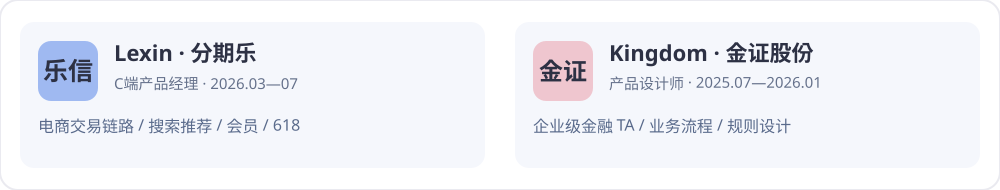

 

### ✦ About me / 关于我
我是 **孔希颖（Xiying Kong）**，华南理工大学金融科技本科毕业生。我的产品经历横跨 **电商 C 端交易与搜索推荐**、**金融 B 端系统设计**，目前重点探索 **AI Agent、Skills、企业级工作流与 Vibe Coding**。

> 我关注的不只是 AI 能生成什么，更关注它如何接入真实业务、遵循规则、处理异常，并交付可验证的结果。

### ◈ Selected AI Projects / AI 项目作品集

| Project | Product problem → AI workflow | Focus |
|:--|:--|:--|
| **01 · DeepSeek 企业财务风险预警 Agent** | 财务报告上传 → 信息识别 → 财务指标交叉校验 → 风险展示；已有 DEMO | Agent · 文档理解 · AI 报告 |
| **02 · AI 商品图生成** | 商品原图 → 白底/透明底、多角度图生成 → Logo 清理与事实一致性审核 | AIGC · Human-in-the-loop |
| **03 · 电商 AI 搜索** | 查询意图理解 → 商品检索与排序 → 可解释的搜索体验设计 | AI Search · NLP |
| **04 · AI 商品自动打标** | 商品信息 → 标签建议 → 规则校验 → 运营使用 | Classification · Automation |
| **05 · 分期乐产品设计 Skills** | 将 C 端与管理端产品设计流程、业务规范和验收标准沉淀为可复用 Skills | Skills · Vibe Coding |

注：项目实现阶段不同。这里展示已知的产品实践与设计方向，不将原型或方案描述为已上线系统。

### ◈ Experience / 实习经历

**乐信集团 · 科技零售部 | C 端产品经理（2026.03—2026.07）**

负责电商黄金流程、商品详情页、搜索推荐、3C 导购及会员促销等产品需求，累计交付 **30+ 项**。参与 618 大促交易链路、商详信息架构和推荐策略迭代；跨团队推进 PRD、评审、联调及上线验收。

**金证股份 · 投资科技事业群 | 产品设计师（2025.07—2026.01）**

参与企业级 TA 4.0 系统的业务规则、账户/交易流程和产品设计。关注异常交易处理、批量操作、数据迁移、复核与可追溯性，将复杂业务约束转化为可落地的产品方案。

### ◈ How I design an Agent

`Business Goal` → `User & Context` → `Task Decomposition` → `Tools / Skills` → `Guardrails & Review` → `Evaluation` → `Iteration`

- **企业办公 Agent：** 权限边界、知识检索、流程编排、人工审批、结果可追溯
- **Vibe Coding / Skills：** 可复用的任务指令、上下文管理、工具调用、产物验收与迭代
- **数据与产品：** Python · SQL · Figma · Axure · PRD · Funnel · A/B Testing

### ◈ GitHub Activity

<picture><source media="(prefers-color-scheme: dark)" srcset="https://raw.githubusercontent.com/kegxthy/kegxthy/output/github-contribution-grid-snake-dark.svg"/></picture>
 ✦ Designed in Snow's palette: white · misty blue · blush pink · cool gray ✦

