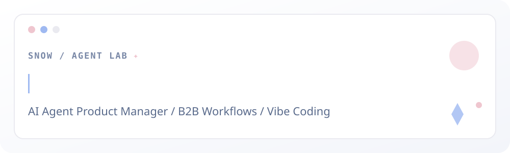

**AI Agent Product Manager · Enterprise Workflows · Skills & Vibe Coding**

*I turn complex business workflows into intuitive products — and explore how AI agents can make them smarter.*

---

<table>
<tr><td width="53%" valign="top">

### 👋 About Me

I'm **Xiying Kong**, a FinTech graduate from **South China University of Technology (SCUT)**, Class of 2026.

My background combines **consumer e-commerce product management** and **enterprise financial software design**. I'm now exploring **AI agents, reusable Skills, office automation, and vibe coding**.

- **Product:** discovery, user journeys, prototypes, PRDs, launch delivery
- **AI:** agent workflow design, human review, evaluation, tool/skill orchestration
- **Data & design:** Python, SQL, Figma, Axure, funnel analysis
- **Languages:** Chinese / English (CET-6)

</td><td width="47%" valign="top">

### ✨ What I'm Exploring

**Enterprise Office Agents**  
Reliable workflows for document processing, knowledge retrieval, reporting, and task automation.

**Skills & Vibe Coding**  
Turning repeatable business rules and product design practices into reusable agent instructions and validation steps.

**AI + Commerce**  
Search experiences, product imagery, attribute tagging, and operational efficiency.

</td></tr>
</table>

### 💼 Internship Experience

<table>
<tr>
<td width="27%" align="center" valign="middle"></td>
<td valign="top"><strong>LEXIN Group · Fintech Mall / Retail Technology</strong> 
Consumer Product Manager · Mar 2026 – Jul 2026  
Owned and delivered improvements across product detail pages, shopping cart, checkout, payments, membership, search and recommendations. Contributed to the 618 shopping festival and shipped <strong>30+ product requirements</strong>, working with engineering, testing and operations from PRD to release.</td>
</tr>
<tr>
<td align="center" valign="middle"></td>
<td valign="top"><strong>Kingdom Technology · Investment Technology Division</strong> 
Product Designer / Product Intern · Jul 2025 – Jan 2026  
Worked on enterprise-grade <strong>Transfer Agency (TA 4.0)</strong> workflows: account operations, transactions, exception handling, review processes and data migration. Translated complex financial business rules into traceable functional designs and acceptance criteria.</td>
</tr>
</table>

### 🤖 Selected AI & Agent Projects

| Project | Problem & product approach | Areas |
|---|---|---|
| **01 · DeepSeek Financial Risk Agent** | Financial-report upload → extraction → ratio cross-check → risk explanation; prototype demo built | Agent workflow · Reports · FinTech |
| **02 · E-commerce Product Image AI** | Generate white-background, transparent-background and multi-angle product visuals, with platform-logo cleanup and review | Generative AI · Human-in-the-loop |
| **03 · AI Shopping Search** | Product concept for understanding search intent, retrieving products and improving result presentation | NLP · AI Search |
| **04 · AI Product Attribute Tagging** | Generate structured product attributes for listing workflows and targeted operations, with rule checks | Automation · Classification |
| **05 · Product Design Skills for Fenqile** | Package consumer-app and admin-console design processes into reusable product-design Skills | Skills · Vibe Coding |

Project descriptions reflect different stages of development, experimentation and product design; prototypes and concepts are not presented as production deployments.

### 🧭 How I Approach Agent Products

`Business Context` → `Task Breakdown` → `Data & Tools` → `Skills / Orchestration` → `Permissions & Review` → `Evaluation`

I care especially about **enterprise reliability**: grounding, business constraints, auditability, exception paths, human oversight and measurable user outcomes.

### 🛠 Product Toolkit

 

### 📈 GitHub Activity

 
<picture>
<source media="(prefers-color-scheme: dark)" srcset="https://raw.githubusercontent.com/kegxthy/kegxthy/output/github-contribution-grid-snake-dark.svg"/>

</picture>
 
Snow Palette · White #FFFFFF · Misty Blue #9FB9F1 · Blush Pink #EFC6CF · Cool Gray #EAEAF0

