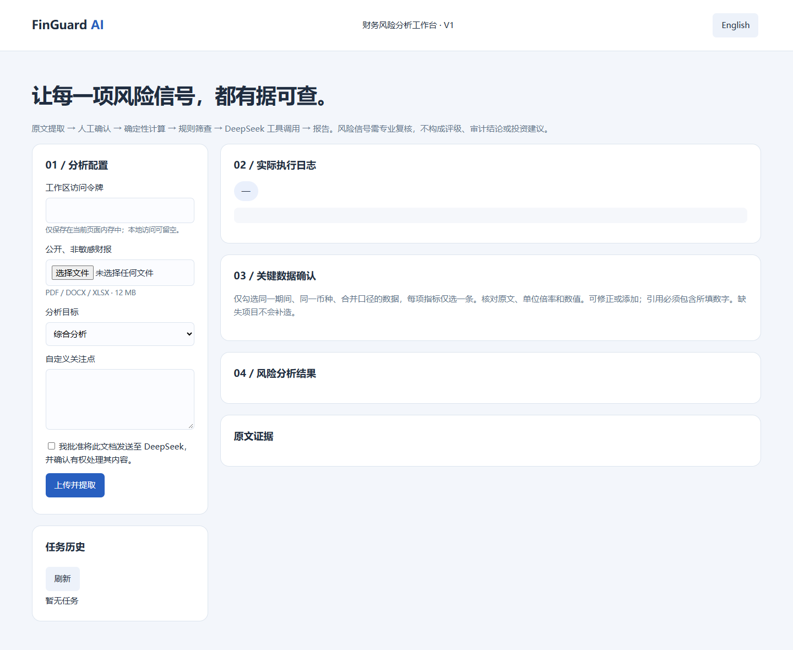

# FinGuard AI V1

[中文](README.md) | **English**

An independent financial-report risk workspace for finance, risk and research teams. Changes are confined to this directory. Modular services and documentation structure are inspired by [MoneyPrinterTurbo](https://github.com/harry0703/MoneyPrinterTurbo); no code is copied.

## Features

- PDF, DOCX and XLSX extraction with page, paragraph, table-row and sheet-row evidence.
- Chunked DeepSeek extraction with schema, verbatim quote and numeric-presence checks, followed by mandatory human confirmation of period, currency, scale and consolidated scope.
- Python Decimal ratios, transparent risk rules and explicit missing-data reasons.
- DeepSeek chooses among three bounded tools: at most four rounds and three calls per round. No shell execution, arbitrary code or web browsing.
- Persistent Chinese/English language choice, analysis presets, custom focus, real event logs, SQLite history, deletion and PDF export.



## Quickstart

Use Python 3.12; no GPU required. From the repository root:

```bash
cd finguard-ai
python -m venv .venv
source .venv/bin/activate
# Windows PowerShell: .venv\Scripts\Activate.ps1
python -m pip install -r requirements.txt
```

Set `LLM_API_KEY` privately in the current shell. Optional `LLM_MODEL` defaults to `deepseek-flash`. Only the official `https://api.deepseek.com` endpoint is approved. The example environment file is not loaded automatically.

```bash
python -m uvicorn server:app --host 127.0.0.1 --port 8000 --workers 1
```

Open http://127.0.0.1:8000. `/health` reports configuration; `/docs` exposes API schemas. Startup and offline tests work without a model key; creating analysis tasks requires one and otherwise returns 503. Never put keys in chat or git.

## Workflow

1. Upload a public, non-sensitive report you are authorized to process; explicitly approve transmission to DeepSeek.
2. Select comprehensive, cash-flow or liquidity review; optionally enter a custom focus.
3. Follow actual extraction events. At `needs_review`, select one consolidated figure per field for one fiscal period and currency. Edit or add figures with verbatim evidence.
4. Confirm to calculate, run rules and invoke the bounded tool agent. Review formulas, sources and tool results, then download PDF.
5. Reopen historical tasks or delete them. Re-enter the workspace token after refreshing.

## Tests

```bash
python -m pip install -r requirements-dev.txt
python -m pytest tests -q
```

Automated model calls are explicitly mocked. Fixtures are never shown as genuine financial analysis. See [validation status](docs/VALIDATION.md) for live-model and deployment gates.

## Deployment and compatibility

See the bilingual [deployment guide](README_DEPLOY.md). `server:app` is the new entrypoint. Legacy `app.py`, `index.html` and `agent_service.py` remain for regression/reference; legacy `/api/analyze` and `/api/upload` are not part of the new application.

`POST /api/reports` is now an asynchronous alias returning 202 and a task ID. The original synchronous response contract has changed. Clients must poll `/api/tasks/{id}` and support human confirmation.

## Limits and security

This is one trusted-team workspace, not a multi-tenant public SaaS. Remote API access requires `FINGUARD_ACCESS_TOKEN`; all holders share all tasks. The token stays in browser memory and the model key stays server-side. Reverse proxies must preserve client addresses correctly. Never forward a tokenless localhost service publicly.

Limits: 12 MB per file, 300 PDF pages, 600,000 extracted characters, 40 MB expanded ZIP, two active jobs, 100 saved tasks, 600 seconds per phase and 60 seconds per provider HTTP request. No OCR; spreadsheet formulas require cached values. Complex table semantics need human review. Run one process and one instance. Interrupted tasks become failed after restart; completed and review tasks persist. There is no distributed queue, automatic execution recovery, organization accounts, encrypted local database, malware sandbox or automated backup.

Quote matching verifies source identity, verbatim text and numeric presence, not semantic truth. Model observations with Arabic digits or invalid source IDs are discarded; remaining interpretation is still not independently verified. Screening thresholds are illustrative and sector-dependent. Signals are not audit conclusions, ratings, default predictions or investment advice. No Z-score is invented.

SQLite stores extracted text, focus, confirmed figures, events and reports, not original files. Default path: `data/tasks.sqlite3`; override with `FINGUARD_DB`. Task deletion does not erase external backups or provider records. Confidential documents require separately approved provider and retention policies.

[Architecture, PRD, API and rules](docs/ARCHITECTURE.md) · [Initial audit](docs/AUDIT.md)
